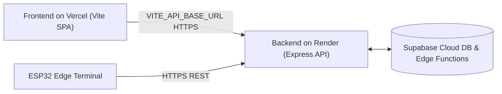

full yo# TAPORAA BIOMETRIC TRANSIT SYSTEM
## Document A — Administrator, Operations, and Deployment Manual

---

### 1. System Overview & Architecture

Taporaa is an enterprise-grade automated biometric fare collection platform for mass transit networks (e.g. Metro rail and bus rapid transit). The system integrates embedded edge hardware, an authenticated Node.js/Express transit backend, a cloud-native Supabase PostgreSQL database, and a responsive Vite + React single-page administrative application.

```mermaid
flowchart TB
    subgraph Hardware ["Edge Hardware Terminal"]
        AS608["AS608 Optical Fingerprint Sensor"] -->|UART TTL 57600 baud| ESP32["ESP32 Microcontroller NodeMCU"]
        ESP32 -->|PWM| SERVO["Gate Barrier SG90 Servo"]
        ESP32 -->|Tone PWM| BUZZER["Piezo Audio Buzzer"]
        ESP32 -->|I2C 0x27| LCD["16x2 I2C Character Display"]
    end

    subgraph Backend ["Transit Core API & Proxy (Port 3000)"]
        EXPRESS["Express Transit Server (server.ts)"]
        AUTH["Token Security (x-device-token)"]
        CACHE["In-Memory Bidirectional Cache"]
        FARE_ENG["Transit Fare Calculation Matrix"]
    end

    subgraph Database ["Cloud Supabase Infrastructure"]
        POSTGRES[("Supabase PostgreSQL DB")]
        EDGE_FN["Deno Edge Functions (/passenger-lookup, /check-in, /check-out)"]
    end

    subgraph WebClients ["Operator & Commuter Portals"]
        ADMIN_UI["Operation Center & Device Monitor (/admin)"]
        COMMUTER_UI["Passenger Mobile Web App (/passenger)"]
    end

    AS608 -->|Biometric Scan| ESP32
    ESP32 -->|HTTPS REST POST (x-device-token)| AUTH
    AUTH --> EXPRESS
    EXPRESS <--> CACHE
    EXPRESS --> FARE_ENG
    EXPRESS <-->|Service Role REST| POSTGRES
    EXPRESS <-->|Edge Function HTTP| EDGE_FN
    ADMIN_UI <-->|REST API + SSE Stream| EXPRESS
    COMMUTER_UI <-->|REST API| EXPRESS
```

---

### 2. Workspace File Structure

```
miniproject/
├── dist/                          # Production Vite frontend build (SPA)
├── docs/
│   ├── DOCUMENT_A_ADMIN_AND_DEPLOYMENT_GUIDE.md  # Administrator manual (this document)
│   └── DOCUMENT_B_PASSENGER_AND_USER_MANUAL.md   # Commuter user guide
├── firmware/
│   ├── sketch_oct6a.ino           # Standalone ESP32 Arduino C++ firmware
│   └── sketch_oct6a/
│       └── sketch_oct6a.ino       # Standard Arduino IDE sketch directory
├── src/
│   ├── components/                # React UI components (GateStatus, StationPicker, etc.)
│   ├── pages/                     # Application pages (Admin, PassengerDashboard, Monitor)
│   ├── services/api.ts            # Frontend HTTP client (supports VITE_API_BASE_URL)
│   └── types/transit.ts           # Shared TypeScript transit data interfaces
├── .env                           # Environment configuration secrets
├── .env.example                   # Deployment template for environment variables
├── package.json                   # Project dependencies and operational scripts
├── render.yaml                    # Production deployment blueprint for Render.com
├── server.ts                      # Authoritative Express API server & proxy engine
├── test_phase5_comprehensive.mjs  # 14-point automated integration test suite
├── tsconfig.json                  # TypeScript compiler configuration
├── vercel.json                    # Production deployment blueprint for Vercel
└── vite.config.ts                 # Frontend build bundler configuration
```

---

### 3. Environment Variables & Secret Configuration

Copy `.env.example` to `.env` and configure each parameter:

| Variable | Description | Security Scope | Required For |
|---|---|---|---|
| `PORT` | Local server port (Default: `3000`) | Server-side | Local & Render host |
| `APP_URL` | Base transit application URL | Server-side | Local & Web links |
| `SUPABASE_URL` | Supabase project REST base URL (`https://<project-ref>.supabase.co`) | Shared | All DB & Edge functions |
| `SUPABASE_ANON_KEY` | Supabase public anon key | Public/Server | Client queries |
| `SUPABASE_SERVICE_ROLE_KEY` | Supabase service-role administrative secret | **Strictly Secret** (Never expose to frontend) | Direct atomic DB updates & bypassing RLS |
| `BIO_DEVICE_TOKEN` | Secret header token verified by Supabase Edge Functions | Server-side only | Edge function calls |
| `ESP32_DEVICE_TOKEN` | Shared secret sent by ESP32 in `x-device-token` header | Hardware & Server | Edge device check-in/out |
| `ADMIN_ACCESS_PASSCODE` | Admin console login password (Default: `123123`) | Server-side | Admin portal access |
| `VITE_API_BASE_URL` | Frontend API target when hosted separately on Vercel | Client-side build | Decoupled cloud deployment |

---

### 4. Supabase Database Schema

The system uses 5 core tables in PostgreSQL:

#### A. `passengers`
- `id` (INTEGER, SERIAL PRIMARY KEY): Unique system identity.
- `fingerprint_id` (INTEGER, UNIQUE NOT NULL): AS608 hardware flash memory slot (1–120).
- `name` (TEXT NOT NULL): Commuter full legal name.
- `wallet_balance` (NUMERIC NOT NULL DEFAULT 0.00): Current prepaid card balance in Indian Rupees (₹).
- `status` (TEXT NOT NULL DEFAULT 'ACTIVE'): Passenger state (`ACTIVE` or `INACTIVE`).
- `created_at` (TIMESTAMPTZ DEFAULT NOW()).

#### B. `journeys`
- `id` (INTEGER, SERIAL PRIMARY KEY): Internal journey ID.
- `journey_code` (TEXT UNIQUE NOT NULL): Human-readable code (e.g. `TAP-JRN-20261103-5173`).
- `passenger_id` (INTEGER REFERENCES passengers(id)): Linked commuter.
- `entry_station_id` (INTEGER NOT NULL): Origin metro station.
- `exit_station_id` (INTEGER NULL): Destination metro station (NULL while active).
- `entry_time` (TIMESTAMPTZ NOT NULL): Boarding timestamp.
- `exit_time` (TIMESTAMPTZ NULL): Alighting timestamp.
- `fare` (NUMERIC NULL): Deducted journey fare in ₹.
- `status` (TEXT NOT NULL): State (`ACTIVE` while traveling, `COMPLETED` on checkout).
- `previous_balance` (NUMERIC NULL): Wallet balance prior to fare deduction.
- `new_balance` (NUMERIC NULL): Wallet balance after alighting.

#### C. `wallet_transactions`
- `id` (INTEGER, SERIAL PRIMARY KEY): Transaction serial.
- `transaction_id` (TEXT UNIQUE): Reference code (e.g. `TXN-8942-FAR`).
- `passenger_id` (INTEGER REFERENCES passengers(id)).
- `journey_id` (INTEGER NULL REFERENCES journeys(id)).
- `transaction_type` (TEXT NOT NULL): `FARE` (deduction) or `TOPUP` (credit).
- `amount` (NUMERIC NOT NULL): Transaction amount in ₹.
- `balance_before` (NUMERIC NOT NULL): Balance before transaction.
- `balance_after` (NUMERIC NOT NULL): Resulting balance.
- `created_at` (TIMESTAMPTZ DEFAULT NOW()).

#### D. `fare_matrix`
- `id` (INTEGER, SERIAL PRIMARY KEY).
- `from_station_id` (INTEGER NOT NULL).
- `to_station_id` (INTEGER NOT NULL).
- `fare` (NUMERIC NOT NULL): Standard fare (e.g. ₹15 to ₹40).

#### E. `devices`
- `id` (TEXT PRIMARY KEY): Terminal identifier (e.g. `ESP32-GATE-MAJ-01`).
- `station_id` (INTEGER NOT NULL).
- `gate_type` (TEXT NOT NULL): `ENTRY` or `EXIT`.
- `status` (TEXT NOT NULL DEFAULT 'ONLINE').
- `last_heartbeat` (TIMESTAMPTZ DEFAULT NOW()).

---

### 5. Administrator Console Guide

Access the Admin Console at `http://localhost:3000/admin` (or `https://<your-domain>/admin`).

#### A. Authentication
1. Enter the Admin Passcode: `123123` (configured via `ADMIN_ACCESS_PASSCODE`).
2. Click **Unlock Transit Console**. The system issues an authenticated session token.

#### B. Commuter Management
1. **Search & Filter**: Search commuters by name, phone, or AS608 Slot #.
2. **Register New Commuter**:
   - Provide Commuter Full Name (e.g. `Kushal`, `Manish`).
   - Assign an available AS608 hardware slot number (1–120).
   - Set Initial Wallet Balance (minimum ₹10, default ₹250).
   - Click **Enroll Passenger**.
   - The platform atomically creates the passenger in Supabase and binds the AS608 biometric slot.
3. **Deactivate Commuter**:
   - Soft-deactivate an account if a commuter loses their card or is temporarily blocked.
   - Deactivated commuters are rejected at turnstiles with `ACCOUNT_INACTIVE` and `gate_command: REJECT`.
4. **Delete Commuter**:
   - Only permitted when no active journeys exist. Past transaction history remains intact.

#### C. Live Operation Center
- **Active Commuters Metric**: Displays currently boarded commuters across all metro lines.
- **System Revenue Metric**: Real-time counter of total collected fares.
- **Live Journey Feed**: Real-time table of check-ins and check-outs with passenger names, boarding stations, and alighting timestamps.

#### D. Biometric Device Monitor
- Live stream of all turnstile events (`SCAN_AUTHORIZED`, `SCAN_UNAUTHORIZED`, `GATE_OPENED`, `PASSENGER_CREATED`).
- Unknown Fingerprint Visual Alert with real-time audio chime warning.

---

### 6. Hardware Setup & Calibration (ESP32 + AS608)

#### A. Wiring Pinout Table

| ESP32 GPIO Pin | AS608 Pin | SG90 Servo Pin | Piezo Buzzer Pin | I2C LCD (0x27) |
|---|---|---|---|---|
| 5V / VIN | Pin 1 (VCC Red) | 5V (Red wire) | — | VCC |
| GND | Pin 2 (GND Black) | GND (Brown wire) | Cathode (-) | GND |
| GPIO 16 (RX2) | Pin 3 (TX Yellow) | — | — | — |
| GPIO 17 (TX2) | Pin 4 (RX White) | — | — | — |
| GPIO 18 | — | Signal (Orange) | — | — |
| GPIO 19 | — | — | Anode (+) | — |
| GPIO 21 (SDA) | — | — | — | SDA |
| GPIO 22 (SCL) | — | — | — | SCL |

#### B. Flashing the ESP32 Firmware
1. Open Arduino IDE (v2.x recommended).
2. Install Required Libraries via Library Manager:
   - `Adafruit Fingerprint Sensor Library`
   - `ESP32Servo`
   - `LiquidCrystal_I2C`
   - `WiFi` & `HTTPClient` (bundled with ESP32 board core)
3. Open `firmware/sketch_oct6a/sketch_oct6a.ino`.
4. Update Wi-Fi and Server configuration:
   ```cpp
   const char* ssid = "YOUR_WIFI_SSID";
   const char* password = "YOUR_WIFI_PASSWORD";
   const char* serverUrl = "http://10.150.1.14:3000"; // Replace with your computer's local IP
   const char* deviceToken = "aaaaaaaaaaaaaaaaaaaaaaaaaaaaaaaaaaaaaaaaaaaaaaaaaaaaaaaaaaaaaaaaaqqqqqqqqqqqqqqqqqqqqqqqwwwwwwwwwwwwwwwwwwwwwww";
   ```
5. Select Board: **ESP32 Dev Module**, Port: **COMx** (e.g. COM3 or COM4).
6. Upload at 115200 baud.

#### C. Audio Buzzer Tones Reference
- **Authorized Commuter Entry/Exit**: Dual harmonious tone (880 Hz followed by 1760 Hz, 80 ms each).
- **Unauthorized Fingerprint**: Five rapid warning beeps at 2000 Hz (60 ms each).
- **Confirmation Wait Window**: Double short chirp at 1200 Hz.
- **Hardware / Network Error**: Single deep buzz at 400 Hz (350 ms).

---

### 7. Deployment Procedures

#### Option A: Local Deployment (Single-Domain Setup)
1. Install dependencies:
   ```bash
   pnpm install
   ```
2. Build frontend production assets:
   ```bash
   pnpm run build
   ```
3. Start the authoritative backend server:
   ```bash
   pnpm run dev
   ```
4. Access the web portals:
   - Platform Entry: `http://localhost:3000`
   - Admin Operation Center: `http://localhost:3000/admin`
   - Commuter Portal: `http://localhost:3000/passenger`
   - Health Check: `http://localhost:3000/api/health`

#### Option B: Cloud Deployment (Vercel Frontend + Render Backend)



##### 1. Backend Deployment on Render.com:
- Connect your GitHub repository to Render.
- Create a **Web Service**:
  - Name: `taporaa-backend`
  - Environment: `Node`
  - Build Command: `pnpm install`
  - Start Command: `npx tsx server.ts`
  - Add Environment Variables (from your `.env`):
    - `SUPABASE_URL`
    - `SUPABASE_ANON_KEY`
    - `SUPABASE_SERVICE_ROLE_KEY`
    - `BIO_DEVICE_TOKEN`
    - `ESP32_DEVICE_TOKEN`
    - `ADMIN_ACCESS_PASSCODE`
    - `CORS_ORIGIN`: `*` (or your Vercel URL)
- Deploy and note your Render URL (e.g. `https://taporaa-backend.onrender.com`).

##### 2. Frontend Deployment on Vercel:
- Connect your GitHub repository to Vercel.
- Framework Preset: **Vite**
- Build Command: `pnpm run build`
- Output Directory: `dist`
- Set Environment Variable:
  - `VITE_API_BASE_URL`: `https://taporaa-backend.onrender.com`
- Deploy. Vercel utilizes `vercel.json` for client-side routing.

##### 3. ESP32 Cloud Connection:
In `sketch_oct6a.ino`, set:
```cpp
const char* serverUrl = "https://taporaa-backend.onrender.com";
```

---

### 8. Troubleshooting & Maintenance

| Symptom | Cause | Remediation |
|---|---|---|
| Sensor returns `404 PASSENGER_NOT_FOUND` | Enrolled in AS608 flash but not registered in Supabase `passengers` table | Open Admin Console, create passenger profile and map to the exact AS608 Slot # |
| Buzzer emits 5 fast 2000Hz beeps | Unregistered finger placed on sensor | Normal security rejection. Device Monitor displays `UNAUTHORIZED_SCAN` alert |
| `NO_ACTIVE_JOURNEY` (400) on exit gate | Commuter tapped exit gate twice or did not tap entry gate | Verify journey status in Admin Console. Tap entry gate first |
| Turnstile servo does not open | Insufficient 5V current to SG90 or pin loose | Power servo via external 5V 2A adapter or verify GPIO 18 PWM connection |
| Node.js port 3000 already in use | Previous server process still running | Run `Get-NetTCPConnection -LocalPort 3000 \| Stop-Process` on Windows |

