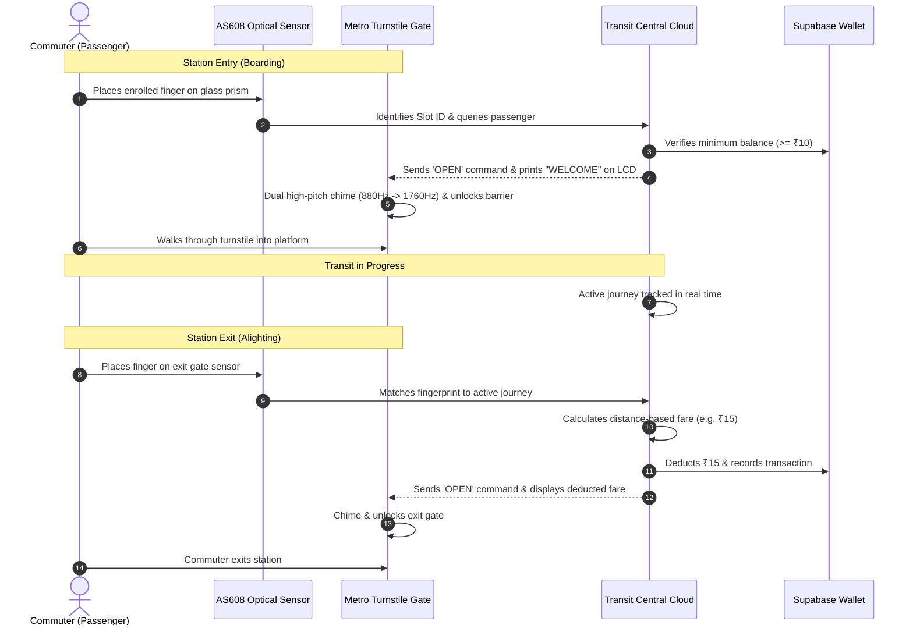

# TAPORAA BIOMETRIC TRANSIT SYSTEM
## Document B — Commuter, Passenger, and Station User Manual

---

### 1. Introduction to Taporaa Smart Transit

Welcome to **Taporaa**, India's next-generation contactless biometric fare collection platform. Taporaa replaces physical smart cards, plastic tokens, and paper QR tickets with your unique fingerprint. 

By utilizing optical fingerprint verification with sub-second matching, Taporaa allows you to board and exit metro stations seamlessly while automatically calculating fares and managing your prepaid transit wallet.

---

### 2. How Biometric Metro Ticketing Works

---

### 3. Step-by-Step Commuter Guide

#### Step 1: Commuter Registration
1. Visit the Customer Service Desk at any Taporaa Metro Station.
2. The transit operator will enroll your index finger on the AS608 optical sensor.
3. The sensor captures a template and assigns an internal slot number.
4. Your account is activated with your legal name, phone number, and initial wallet recharge.

#### Step 2: Entering the Metro Station (Check-In)
1. Approach any turnstile marked **ENTRY GATE**.
2. Rest your enrolled finger flat and firmly on the green glowing optical sensor prism.
3. Observe the LCD Screen:
   - **`WELCOME <NAME>`**: Your fingerprint has been recognized.
   - **`BAL: ₹XXX`**: Your current wallet balance is shown.
4. Listen for the sound:
   - A pleasant **two-tone chime** signals authorization.
5. The motorized gate opens automatically. Proceed through the turnstile.

#### Step 3: Traveling on the Transit Network
- Your journey status is updated immediately to **IN_PROGRESS** in the transit cloud.
- You can track your journey from your smartphone at `http://localhost:3000/passenger`.

#### Step 4: Exiting the Destination Station (Check-Out)
1. Approach any turnstile marked **EXIT GATE**.
2. Place the same finger on the exit sensor.
3. The system matches your active journey with the exit station:
   - The distance-based fare is calculated from the transit fare matrix.
   - The fare is deducted from your balance in a single atomic transaction.
4. Observe the LCD Screen:
   - **`GATE OPEN - FARE: ₹15`**
   - **`NEW BAL: ₹XXX`**
5. The gate opens. Walk through to complete your commute.

---

### 4. Audio-Visual Feedback Guide

Taporaa provides clear visual displays and auditory tones so you always know your gate status:

| Sensor State | LCD Display Message | Buzzer Sound | Gate Barrier | Meaning / Action Required |
|---|---|---|---|---|
| **Authorized Entry** | `WELCOME <NAME>` `BAL: ₹XXX` | Dual Harmonious Chime (880Hz + 1760Hz) | **OPENS** | Access granted. Walk through turnstile. |
| **Authorized Exit** | `GATE OPEN - FARE: ₹15` `NEW BAL: ₹XXX` | Dual Harmonious Chime (880Hz + 1760Hz) | **OPENS** | Journey completed and fare deducted. |
| **Unregistered Finger** | `UNKNOWN FINGER` `ACCESS DENIED` | 5 Fast Warning Beeps (2000Hz) | **REMAINS LOCKED** | Finger not enrolled. Contact station customer service. |
| **Low Wallet Balance** | `LOW BAL: ₹X` `MIN ₹10 REQ` | Deep Error Buzz (400Hz) | **REMAINS LOCKED** | Wallet balance is below ₹10. Please recharge wallet before boarding. |
| **Already Checked In** | `ACTIVE JOURNEY` `USE EXIT GATE` | Deep Error Buzz (400Hz) | **REMAINS LOCKED** | You are already checked in. Proceed to exit gate to complete journey. |
| **No Active Journey** | `NO ACTIVE JOURNEY` `ENTRY REQUIRED` | Deep Error Buzz (400Hz) | **REMAINS LOCKED** | You cannot exit without an entry scan. Contact station staff. |

---

### 5. Passenger Web Dashboard Guide

Manage your transit card anytime by opening the **Passenger Mobile Web Portal** (`http://localhost:3000/passenger`).

#### A. Viewing Your Balance & Profile
- Select your registered name (e.g. **Manish**, **Kushal**) from the commuter switcher or scan your ID.
- View your **Live Wallet Balance**, account status (**ACTIVE**), and contact details.

#### B. Active Journey Live Card
- When you are currently traveling on a train, an **Active Journey Banner** appears at the top of your dashboard.
- Shows your **Origin Station**, **Boarding Time**, and an animated transit indicator.
- On mobile devices, an emergency **Self Check-Out** button is available if hardware maintenance is underway.

#### C. Recharging Your Transit Wallet (Top-Up)
1. On your passenger dashboard, click **Top Up Balance**.
2. Select an amount (₹100, ₹200, ₹500, or custom amount).
3. Confirm payment. Your wallet balance is instantly credited in Supabase and available at all physical turnstiles immediately.

#### D. Reviewing Travel & Transaction History
- **Recent Journeys**: Detailed timeline of past travels including date, origin station, destination station, and fare paid.
- **Wallet Passbook**: Statement showing all deductions (Fare Deductions) and credits (Recharges) with timestamped transaction IDs.

---

### 6. Frequently Asked Questions (FAQ)

**Q1: What if my finger is wet, dusty, or cold?**  
*A:* Wipe your finger clean and press down with moderate, flat pressure on the glass prism. Do not slide or tap too quickly. Hold for half a second until the green light flashes.

**Q2: What happens if my wallet balance is lower than the trip fare during exit?**  
*A:* Taporaa requires a minimum balance of ₹10 to enter the system. If your journey exceeds your balance, the exit gate will display `LOW BAL - RECHARGE`. Simply open the web portal on your mobile phone, add funds via the Top-Up button, and tap the exit sensor again.

**Q3: Can someone else use my fingerprint?**  
*A:* No. The AS608 optical sensor matches unique minutiae points stored securely on the hardware module. Duplicate scans are rejected and logged in the Station Device Monitor.

**Q4: Can I be charged twice if I tap twice?**  
*A:* No. Taporaa features an automatic duplicate-tap lock. Once a check-out is registered, repeated taps are rejected with `NO_ACTIVE_JOURNEY` and zero additional fare is charged.

