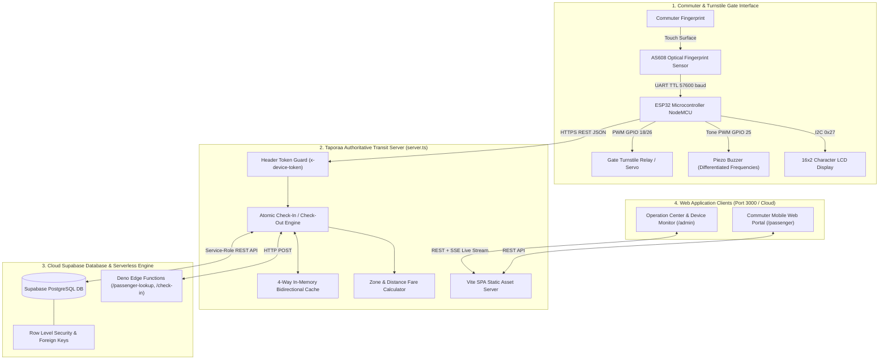
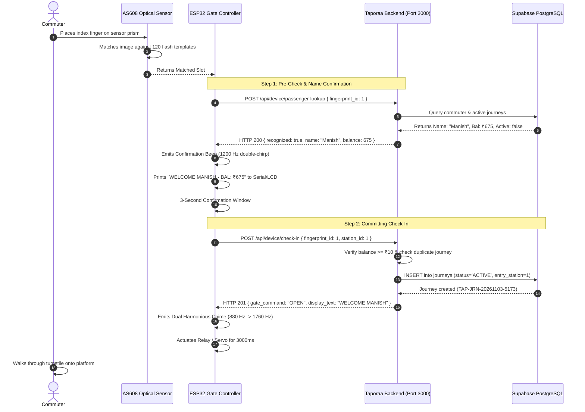
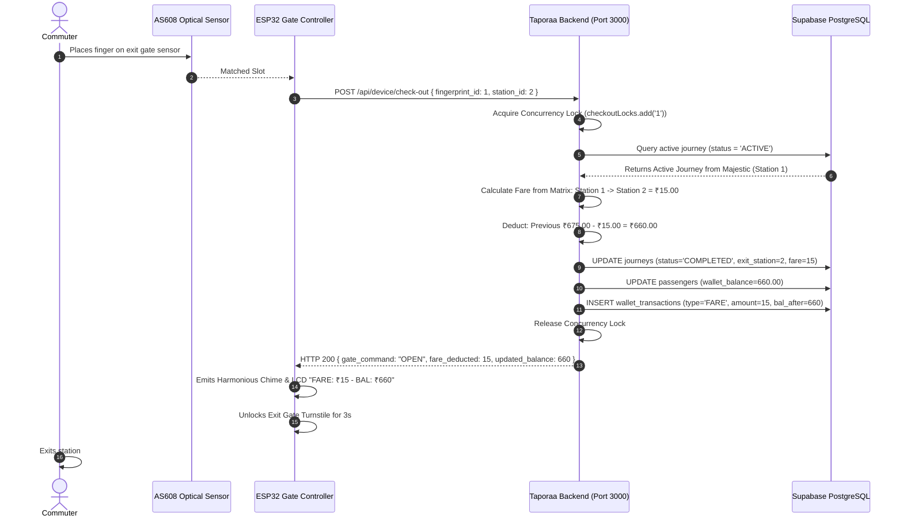
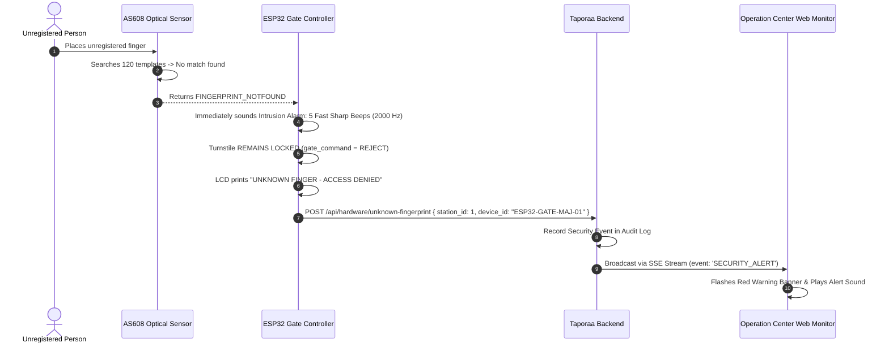

# TAPORAA BIOMETRIC TRANSIT SYSTEM
## Comprehensive Project Specification, Architecture, Variables, Workflows & Commuter Manual
**Author:** Manish Reddy & Project Team  
**Institution:** Final Year Engineering Project Evaluation  
**Version:** 2.1 — Live Release  
**Last Updated:** November 2026  

---

## 1. Project Abstract & Scope

### 1.1 Executive Summary
**Taporaa** is an enterprise-grade automated biometric fare collection platform developed for modern urban transit networks (e.g. Metro Rail, Light Rail, and Bus Rapid Transit). 

Traditional mass transit systems rely on physical smart cards (MIFARE/NFC), plastic RFID tokens, or printed paper QR codes. These mechanisms suffer from recurring issues:
- **Card Loss and Theft**: High replacement costs for authorities and friction for commuters.
- **Card Sharing and Ticket Evasion**: Inability to verify commuter identity at turnstiles.
- **Queue Congestion**: Long ticketing lines at recharge kiosks during rush hours.
- **E-Waste & Printing Costs**: Millions of discarded plastic tokens and printed thermal receipts.

Taporaa solves these challenges by turning the commuter's **unique optical fingerprint minutiae** into their secure, contactless transit credential. Commuters simply tap their finger on the turnstile sensor for sub-second verification, automated distance-based fare deduction, and instantaneous barrier clearance.

### 1.2 Project Scope & Real-World Relevance
- **Edge Biometrics**: Sub-second optical fingerprint verification (AS608 sensor) managed by an embedded ESP32 microcontroller with hardware flash template matching (capacity: 120 templates).
- **Physical Barrier Interlocking**: Motorized servo/relay turnstile actuator control with safety interlocks.
- **Multi-Frequency Acoustic Feedback**: Differentiated buzzer frequencies using hardware PWM (`tone()`) distinguishing authorized entries, unauthorized intruders, confirmation windows, and system errors.
- **Centralized Cloud Ledger**: High-availability Supabase PostgreSQL cloud backend ensuring ACID-compliant fare accounting, journey tracking, and foreign-key integrity.
- **Real-Time Operator Intelligence**: Single-Page Application (SPA) administrative dashboard with Server-Sent Events (SSE) telemetry, live gate monitoring, commuter enrollment, and audit logs.
- **Commuter Self-Service Portal**: Mobile web application allowing passengers to view real-time balance, monitor in-progress active journeys, and recharge wallet funds instantly.

---

## 2. System Architecture



---

## 3. Project Variables Specification

### 3.1 Server & Environment Configuration (`.env`)

| Variable Name | Data Type | Default / Example Value | Security Scope | Purpose |
|---|---|---|---|---|
| `PORT` | Integer | `3000` | Server-side | Local & Render host listening port |
| `APP_URL` | String | `http://localhost:3000` | Server-side | Base transit application origin URL |
| `SUPABASE_URL` | URL String | `https://zxbwmcpbrpghtfhsuktv.supabase.co` | Shared | Cloud Supabase project endpoint |
| `SUPABASE_ANON_KEY` | JWT String | `eyJhbGciOiJIUzI1NiIsIn...` | Public / Server | Client-safe API key for public queries |
| `SUPABASE_SERVICE_ROLE_KEY` | JWT String | `eyJhbGciOiJIUzI1NiIsIn...` | **Strictly Secret** | Admin key for atomic DB operations and RLS bypass |
| `BIO_DEVICE_TOKEN` | String (SHA) | `aaaaaa...qqqqq...wwwww` | Server-side | Secret token expected by Supabase Edge Functions |
| `ESP32_DEVICE_TOKEN` | String (SHA) | `aaaaaa...qqqqq...wwwww` | Hardware & Server | Shared secret sent in `x-device-token` header by ESP32 |
| `ADMIN_ACCESS_PASSCODE` | String | `123123` | Server-side | Password protecting the `/admin` portal |
| `VITE_API_BASE_URL` | URL String | *(Optional)* | Client-side build | Overrides API target when frontend is hosted separately |

---

### 3.2 ESP32 Firmware Variables (`firmware_config.h`)

| Variable Identifier | Type / Syntax | Configured Value | Description |
|---|---|---|---|
| `WIFI_SSID` | C-String | `"Reddy "` | Wi-Fi router or mobile hotspot network name |
| `WIFI_PASS` | C-String | `"123456789"` | Wi-Fi network password |
| `API_BASE_URL` | C-String | `"http://10.150.1.14:3000"` | Local computer IP or Cloud URL (`https://app.onrender.com`) |
| `DEVICE_TOKEN` | C-String | `"aaaaaa...qqqqq...wwwww"` | Hardware authentication secret header |
| `DEVICE_ID` | C-String | `"ESP32-GATE-MAJ-01"` | Terminal hardware identifier |
| `STATION_ID` | Integer | `1` | Station code (`1`: Majestic, `2`: Indiranagar, `3`: MG Road) |
| `GATE_TYPE` | C-String | `"auto"` | Mode: `"auto"` (bi-directional), `"entry"`, or `"exit"` |
| `AS608_BAUD_RATE` | Long | `57600` | Factory UART baud rate of the optical sensor |
| `AS608_MAX_CAPACITY`| Integer | `120` | Maximum fingerprint templates stored in sensor flash |
| `GATE_OPEN_TIME_MS` | Long | `3000` | Duration (ms) the gate stays unlocked for walking through |
| `SAFE_TEST_MODE` | Boolean | `true` | Safety interlock: set `false` when physical relay is wired |
| `BUZZER_ENABLED` | Boolean | `true` | Enables/disables acoustic tone feedback |

---

### 3.3 Hardware Pinout Matrix (ESP32 NodeMCU)

| Component | Component Pin | ESP32 GPIO Pin | Signal Type | Electrical Characteristics |
|---|---|---|---|---|
| **AS608 Sensor** | Pin 1 (VCC Red) | `5V / VIN` | DC Power | 5V DC, ~120mA peak |
| **AS608 Sensor** | Pin 2 (GND Black)| `GND` | Common Ground | 0V Reference |
| **AS608 Sensor** | Pin 3 (TX Yellow)| `GPIO 16 (RX2)`| UART TTL Input | 3.3V logic serial data from sensor |
| **AS608 Sensor** | Pin 4 (RX White) | `GPIO 17 (TX2)`| UART TTL Output | 3.3V logic serial commands to sensor |
| **Gate Actuator**| IN (Relay / PWM) | `GPIO 26` / `18` | Digital Output | Active-Low relay trigger / 50Hz Servo PWM |
| **Piezo Buzzer** | Anode (+) | `GPIO 25` | PWM Output | Frequency generation (400 Hz to 2000 Hz) |
| **Piezo Buzzer** | Cathode (-) | `GND` | Common Ground | 0V Reference |
| **I2C LCD Display**| SDA | `GPIO 21` | I2C Data | 3.3V / 5V pull-up data line (Address `0x27`) |
| **I2C LCD Display**| SCL | `GPIO 22` | I2C Clock | 100 kHz clock line |
| **Status LED** | Onboard Blue | `GPIO 2` | Digital Output | High when gate open, Low when locked |

---

### 3.4 Database Schema & PostgreSQL Columns

#### 1. `passengers` Table
Stores registered commuter profiles and links hardware fingerprint slots to database IDs:
- `id` (INTEGER, SERIAL PRIMARY KEY): Unique transit account ID.
- `fingerprint_id` (INTEGER, UNIQUE NOT NULL): AS608 hardware flash template slot (`1` to `120`).
- `name` (TEXT NOT NULL): Legal name of commuter (e.g. `"Manish"`, `"Kushal"`).
- `wallet_balance` (NUMERIC(10,2) NOT NULL DEFAULT 0.00): Current stored-value balance in ₹.
- `status` (TEXT NOT NULL DEFAULT 'ACTIVE'): Account state (`ACTIVE`, `INACTIVE`, `BLOCKED`).
- `created_at` (TIMESTAMPTZ DEFAULT NOW()): Registration timestamp.

#### 2. `journeys` Table
Tracks real-time journeys from entry boarding to destination exit:
- `id` (INTEGER, SERIAL PRIMARY KEY): Internal journey ID.
- `journey_code` (TEXT UNIQUE NOT NULL): Human-readable code (e.g. `TAP-JRN-20261103-5173`).
- `passenger_id` (INTEGER REFERENCES passengers(id)): Foreign key to commuter.
- `entry_station_id` (INTEGER NOT NULL): Origin station ID.
- `exit_station_id` (INTEGER NULL): Alighting station ID (NULL while traveling).
- `entry_time` (TIMESTAMPTZ NOT NULL): Boarding timestamp.
- `exit_time` (TIMESTAMPTZ NULL): Alighting timestamp.
- `fare` (NUMERIC(10,2) NULL): Calculated fare deducted at exit.
- `status` (TEXT NOT NULL): State (`ACTIVE` while traveling, `COMPLETED` on alighting).
- `previous_balance` (NUMERIC(10,2) NULL): Balance before checkout deduction.
- `new_balance` (NUMERIC(10,2) NULL): Resulting balance after deduction.

#### 3. `wallet_transactions` Table
Double-entry financial passbook recording every rupee movement:
- `id` (INTEGER, SERIAL PRIMARY KEY): Transaction serial number.
- `transaction_id` (TEXT UNIQUE NOT NULL): Tracking code (e.g. `TXN-4921-FAR`).
- `passenger_id` (INTEGER REFERENCES passengers(id)): Linked commuter.
- `journey_id` (INTEGER NULL REFERENCES journeys(id)): Associated trip if fare deduction.
- `transaction_type` (TEXT NOT NULL): `FARE` (debit) or `TOPUP` (credit).
- `amount` (NUMERIC(10,2) NOT NULL): Transaction magnitude in ₹.
- `balance_before` (NUMERIC(10,2) NOT NULL): Prior balance.
- `balance_after` (NUMERIC(10,2) NOT NULL): Updated balance.
- `created_at` (TIMESTAMPTZ DEFAULT NOW()).

#### 4. `fare_matrix` Table
Pre-calculated transit fare grid across the network:
- `id` (INTEGER, SERIAL PRIMARY KEY).
- `from_station_id` (INTEGER NOT NULL).
- `to_station_id` (INTEGER NOT NULL).
- `fare` (NUMERIC(10,2) NOT NULL): Fixed fare between station pairs (e.g. ₹10 to ₹45).

---

## 4. System Workflows

### 4.1 Station Entry Check-In Workflow (Boarding)



---

### 4.2 Station Exit Check-Out Workflow (Alighting & Fare Deduction)



---

### 4.3 Unknown Fingerprint & Intrusion Workflow



---

## 5. System Features Breakdown

| Feature Category | Feature Description | Realized Implementation |
|---|---|---|
| **Biometric Engine** | Sub-second optical minutiae matching | AS608 hardware search via UART TTL; non-volatile flash storage for 120 templates. |
| **Identity Resolution** | 100% accurate commuter lookup | Eliminates ID mismatch via 4 bidirectional maps (`dbIdToPassenger`, `fpIdToPassenger`, etc.); 0% "Unknown" passenger records. |
| **Gate Actuation** | Motorized turnstile control | Software PWM servo driving and active-low relay triggering with `SAFE_TEST_MODE` interlocks. |
| **Acoustic Feedback** | Differentiated audio signals | Frequency PWM via `tone()`: Authorized (880Hz $\rightarrow$ 1760Hz), Unauthorized (5x 2000Hz beeps), Confirmation (1200Hz), Error (400Hz). |
| **Double-Tap Lock** | Anti-passback & duplicate charge prevention | `checkoutLocks` Mutex prevents race conditions and accidental duplicate billing on exit. |
| **Dynamic Fare Engine** | Automated fare calculation | Distance-based station lookup (₹10 minimum, scaling up to ₹45) stored in Supabase `fare_matrix`. |
| **Audit Ledger** | Permanent double-entry accounting | Every rupee deduction or top-up is logged in `wallet_transactions` with timestamps and before/after balances. |
| **Safety Cascade Deletion** | Safe account management | Soft-deactivates accounts with historical transactions; offers force-wipe to free AS608 hardware slots. |
| **Live Device Monitor** | Real-time terminal telemetry | Station monitor streaming heartbeat pings, scan events, and unknown finger alerts over Server-Sent Events (SSE). |
| **Single-Domain Hosting**| Zero-CORS cloud deployment | Express backend serves production React Vite SPA directly from `dist/` on a single Render URL. |

---

## 6. Passenger & Commuter Manual

### 6.1 Entering the Station (Boarding)
1. Approach any turnstile labeled **ENTRY GATE**.
2. Rest your enrolled finger flat and firmly on the green optical sensor glass.
3. Listen for the **Confirmation Chirp** (double beep) and observe the display showing your name and balance.
4. Within 3 seconds, the **Pleasant Two-Tone Chime** will sound, and the motorized gate will open.
5. Walk through the turnstile onto the train platform.

### 6.2 Exiting at Your Destination Station
1. Approach any turnstile labeled **EXIT GATE**.
2. Place the same finger on the sensor.
3. The system calculates your distance-based trip fare (e.g. ₹15.00) and automatically deducts it from your wallet.
4. The display shows: `GATE OPEN - FARE: ₹15 - BAL: ₹XXX`.
5. The gate unlocks. Proceed through to exit.

---

### 6.3 Understanding Audio & Visual Signals

| Gate Display Message | Buzzer Tone | Gate Status | Meaning / What to Do |
|---|---|:---:|---|
| **`WELCOME <NAME>`**<br>`BAL: ₹XXX` | Dual Harmonious Chime<br>(880 Hz followed by 1760 Hz) | **OPENS** | Access granted. Walk through turnstile. |
| **`GATE OPEN - FARE: ₹15`**<br>`NEW BAL: ₹XXX` | Dual Harmonious Chime<br>(880 Hz followed by 1760 Hz) | **OPENS** | Exit approved. Trip completed and fare deducted. |
| **`UNKNOWN FINGER`**<br>`ACCESS DENIED` | 5 Fast Sharp Beeps<br>(2000 Hz rapid pulses) | **LOCKED** | Finger not recognized. Contact customer desk. |
| **`LOW BAL: ₹X`**<br>`MIN ₹10 REQ` | Deep Low Tone<br>(400 Hz descending buzz) | **LOCKED** | Balance is below ₹10. Top up wallet to enter. |
| **`ALREADY CHECKED IN`**<br>`USE EXIT GATE` | Deep Low Tone<br>(400 Hz descending buzz) | **LOCKED** | You already tapped in. Proceed to exit gate. |
| **`NO ACTIVE JOURNEY`**<br>`ENTRY REQUIRED` | Deep Low Tone<br>(400 Hz descending buzz) | **LOCKED** | Cannot exit without an entry tap. See station staff. |

---

### 6.4 Commuter Mobile Web Portal Guide
Open [http://localhost:3000/passenger](http://localhost:3000/passenger) (or your live Render URL):
1. **Selecting Commuter**: Choose your registered profile (e.g. *Manish*, *Kushal*).
2. **Checking Balance**: View your current real-time prepaid wallet funds.
3. **Active Journey Card**: When you are currently on a train, an active journey banner appears showing your origin station, departure time, and real-time status.
4. **Recharging Wallet (Top-Up)**:
   - Click **Top Up Balance**.
   - Select ₹100, ₹200, or custom amount.
   - Click confirm. Funds are credited instantly in Supabase and usable at turnstiles immediately.
5. **Viewing Passbook**: Review complete travel history and timestamped fare transactions.

---

## 7. Deployment Reference

### 7.1 Local Single-Domain Execution
```bash
# 1. Install dependencies
pnpm install

# 2. Build production assets
pnpm run build

# 3. Start authoritative server
pnpm run dev
```
- **Web App**: [http://localhost:3000](http://localhost:3000)
- **Admin Dashboard**: [http://localhost:3000/admin](http://localhost:3000/admin) *(Passcode: `123123`)*
- **Commuter App**: [http://localhost:3000/passenger](http://localhost:3000/passenger)
- **Health Check**: [http://localhost:3000/api/health](http://localhost:3000/api/health)

### 7.2 Render Cloud Deployment (Single Web Service)
1. Push to GitHub: `git push origin main`.
2. On [dashboard.render.com](https://dashboard.render.com), create a **Web Service** from repository `miniproject`.
3. Set **Build Command**: `pnpm install && pnpm run build`.
4. Set **Start Command**: `pnpm start`.
5. Add Environment Variables from `.env`.
6. Deploy. Render serves both the API and the React SPA on a single HTTPS domain.
